<p align="center">
  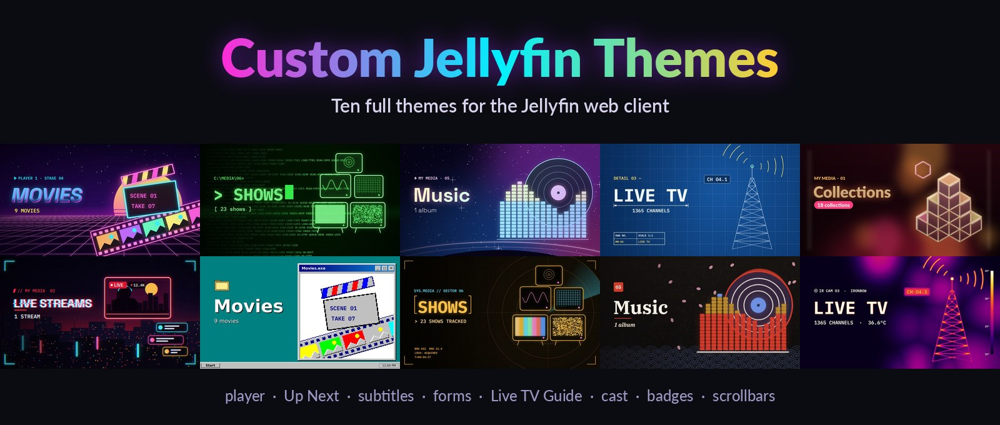
</p>

<p align="center">
  <b>Ten complete themes for the Jellyfin web client</b><br>
  Every screen restyled, from the home page to the video player, in pure CSS with optional animated effects.
</p>

<p align="center">
  
  
  
  
</p>

<p align="center">
  <a href="#the-themes">The themes</a> ·
  <a href="#whats-themed">What's themed</a> ·
  <a href="#install">Install</a> ·
  <a href="#adapting-it">Adapting it</a> ·
  <a href="#how-it-works">How it works</a> ·
  <a href="PRIVACY.md">Privacy</a>
</p>

---

## The themes

Pick one per user in **Settings > Display > Theme**, and again under **Server Dashboard theme** for the admin pages. Each tile below is that theme's own library artwork.

<table>
  <tr>
    <td width="50%" valign="top">
      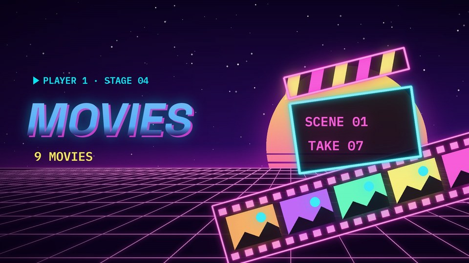<br>
      <b>Neon Arcade</b> <code>neon</code><br>
      <br>
      Synthwave sunset over a scrolling grid floor, magenta and cyan neon tubes, a chrome-italic title.
    </td>
    <td width="50%" valign="top">
      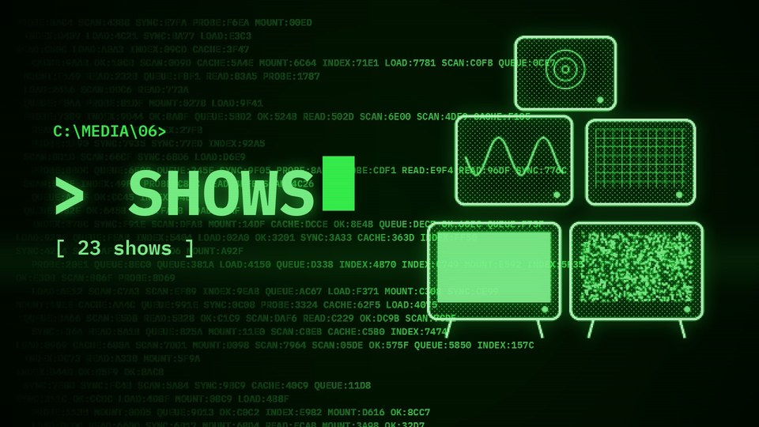<br>
      <b>Phosphor</b> <code>terminal</code><br>
      <br>
      A green-screen console: monospace type, <code>&gt;</code> prompts, block-character bars, Matrix rain.
    </td>
  </tr>
  <tr>
    <td valign="top">
      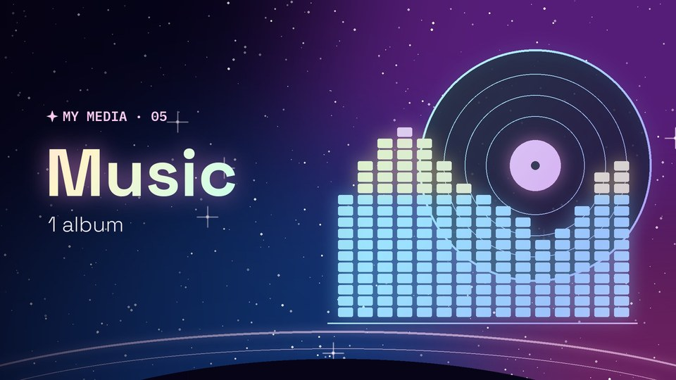<br>
      <b>Cosmos</b> <code>cosmos</code><br>
      <br>
      Deep space with glass panels, pink-to-sky foil gradients and a planet loader with a spinning foil ring.
    </td>
    <td valign="top">
      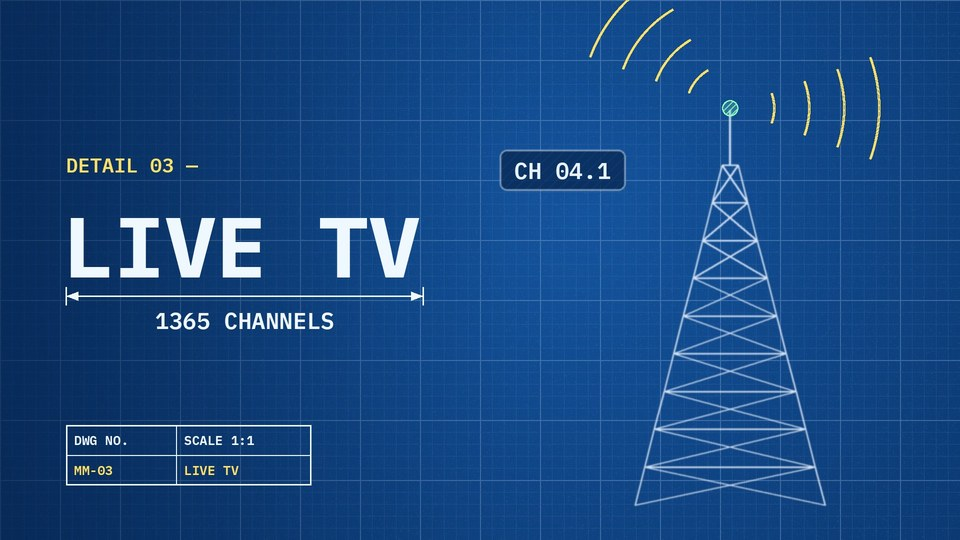<br>
      <b>Blueprint</b> <code>blueprint</code><br>
      <br>
      A technical drawing: grid paper, dimension lines, title blocks and a drafting crosshair.
    </td>
  </tr>
  <tr>
    <td valign="top">
      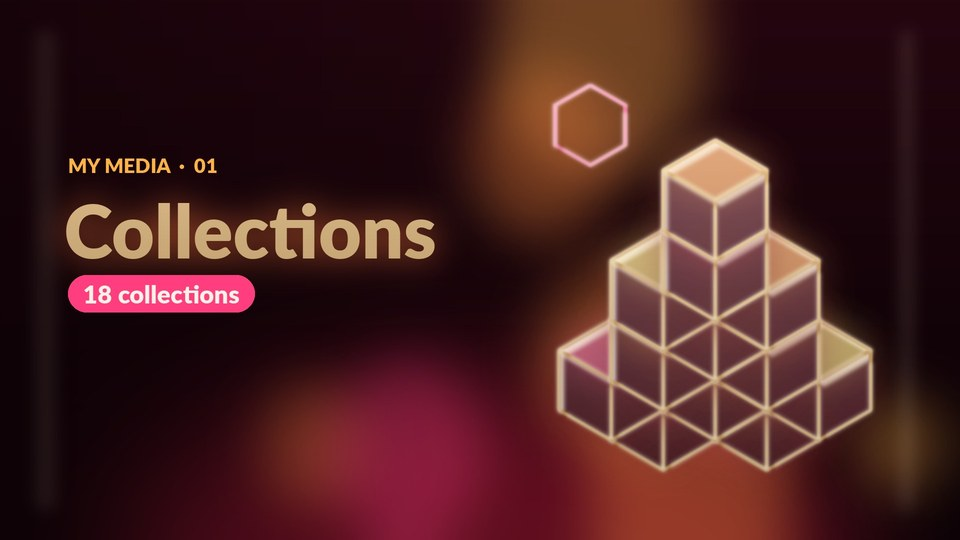<br>
      <b>Lava Lamp</b> <code>lava</code><br>
      <br>
      Warm molten blobs, soft capsules and gradients that slowly flow.
    </td>
    <td valign="top">
      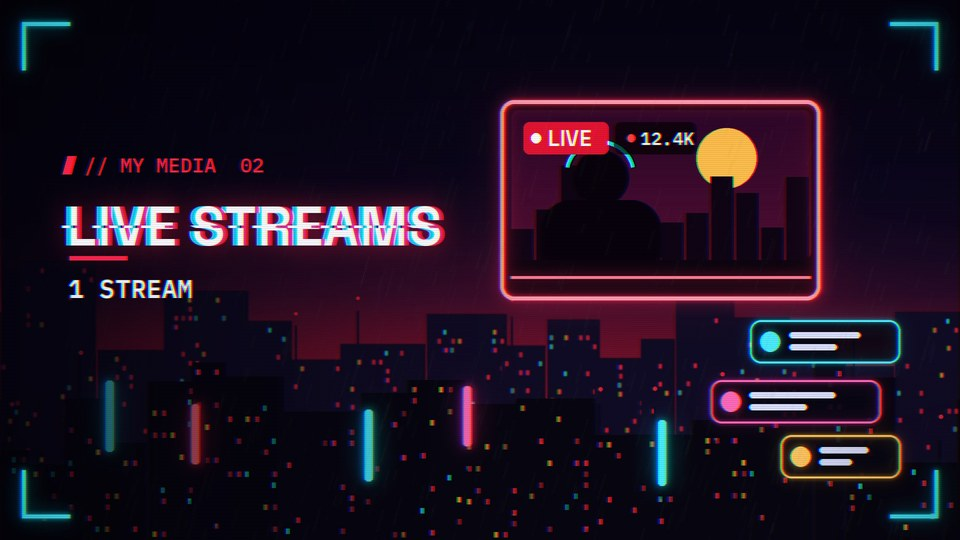<br>
      <b>Cyberpunk</b> <code>cyberpunk</code><br>
      <br>
      Cut corners, red/cyan chromatic splits, katakana signage and titles that "decrypt".
    </td>
  </tr>
  <tr>
    <td valign="top">
      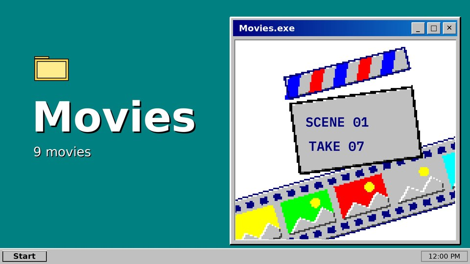<br>
      <b>Desktop 95</b> <code>desktop95</code><br>
      <br>
      A 1995 desktop: teal wallpaper, bevelled grey windows, navy title bars, chequered scrollbars.
    </td>
    <td valign="top">
      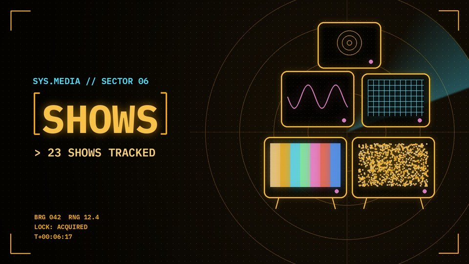<br>
      <b>Mission HUD</b> <code>hud</code><br>
      <br>
      An amber head-up display with corner brackets, telemetry readouts and a cyan lock-on reticle.
    </td>
  </tr>
  <tr>
    <td valign="top">
      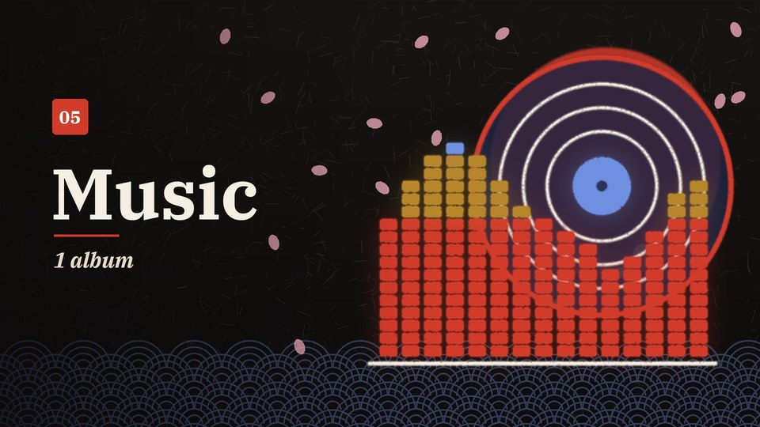<br>
      <b>Sakura</b> <code>sakura</code><br>
      <br>
      Sumi ink and vermilion: serif type, hanko seals and falling cherry petals.
    </td>
    <td valign="top">
      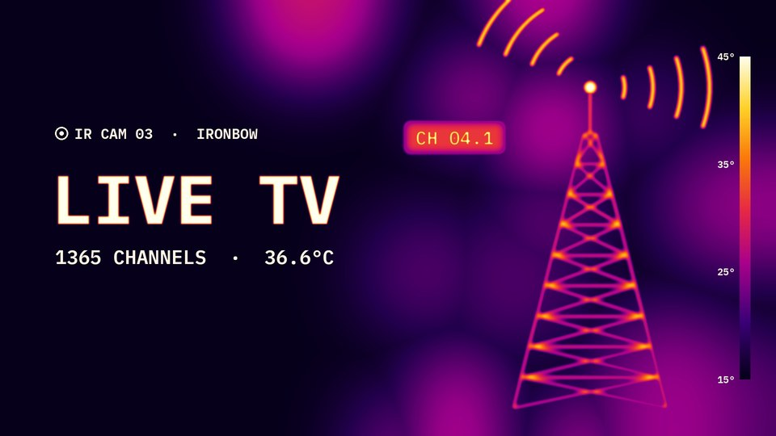<br>
      <b>Thermal Vision</b> <code>thermal</code><br>
      <br>
      An infrared camera: ironbow gradients, white-hot highlights and a temperature scale.
    </td>
  </tr>
</table>

## What's themed

| Area | What changes per theme |
|---|---|
| **Pages and cards** | Wallpaper and decorations, card frames and hover, section titles with their own hover animation |
| **Hover text** | Card titles, side-drawer items and header links animate in the theme's style when pointed at (needs `effects.js`) |
| **My Media** | Library tiles drawn in the theme's style |
| **Loading** | Each theme draws its own loading animation |
| **Video player** | Seek bar, buttons, play button, time readout, the "Up Next" card, subtitle typeface and outline |
| **Settings, search and menus** | Panels, text fields, drop-downs, checkboxes, the Save button, pop-up menus |
| **Badges and progress** | Unwatched counts, watched ticks, resume progress bars |
| **Cast and crew** | Round photo frames, names and roles |
| **Live TV Guide** | The grid, the "on now" cells, channel numbers, LIVE / NEW tags |
| **Scrollbars** | Colour and shape, up to Desktop 95's classic chequered bar |
| **Server Dashboard** | Every admin page: the side drawer, panels and cards, settings forms, buttons, tables and the Activity list |
| **Screensavers** | One animated scene per theme, built from your own posters and backdrops (optional, see below) |

## Install

> **Requirements:** Jellyfin 12.2 (web client 12.2) and access to the server's files, for example a Docker bind
> mount.

**1. Serve the theme folder.** Put `themes/` inside jellyfin-web as `themes/homepage`:

```yaml
services:
  jellyfin:
    volumes:
      - ./custom-jellyfin-themes/themes:/jellyfin/jellyfin-web/themes/homepage:ro
```

**2. List the themes.** Add these entries to the `themes` array in jellyfin-web's `config.json` (mount a patched
copy the same way):

```json
{ "name": "Neon Arcade",    "id": "homepage/neon",      "color": "#2a0a5e" },
{ "name": "Phosphor",       "id": "homepage/terminal",  "color": "#021402" },
{ "name": "Cosmos",         "id": "homepage/cosmos",    "color": "#120a33" },
{ "name": "Blueprint",      "id": "homepage/blueprint", "color": "#0b3a75" },
{ "name": "Lava Lamp",      "id": "homepage/lava",      "color": "#2a0712" },
{ "name": "Desktop 95",     "id": "homepage/desktop95", "color": "#008080" },
{ "name": "Mission HUD",    "id": "homepage/hud",       "color": "#0a0804" },
{ "name": "Thermal Vision", "id": "homepage/thermal",   "color": "#0a001a" },
{ "name": "Cyberpunk",      "id": "homepage/cyberpunk", "color": "#07070b" },
{ "name": "Sakura",         "id": "homepage/sakura",    "color": "#1f1a17" }
```

**3. Add the Custom CSS.** Paste [`custom-css/aurora-glass.css`](custom-css/aurora-glass.css) into
**Dashboard > General > Custom CSS**. It is the base the themes recolour through its `--dcs-*` variables.

**4. Optional: animated effects.** Load [`themes/effects.js`](themes/effects.js) on every page with the
JavaScript Injector plugin (`src`: `/web/themes/homepage/effects.js`). It adds each theme's motion: Matrix rain,
a lock-on reticle, falling petals and more. It pauses during playback, in hidden tabs and with reduced motion.
Jellyfin serves these files without cache headers, so browsers can keep an old copy for days. After updating them,
change a version tag on the `src`, for example `/web/themes/homepage/effects.js?v=2`; `effects.js` passes the same tag
on to `effects.css`.

**Optional: themed screensavers.** Load [`themes/screensavers.js`](themes/screensavers.js) the same way (`src`:
`/web/themes/homepage/screensavers.js`), then pick one in **Settings > Display > Screensaver**. Each is made from
random movies and shows in your library:

| Screensaver | What happens |
|---|---|
| Neon Arcade: Night Drive | A synthwave drive at 120 bpm with your posters as neon billboards, each scoring points as it passes |
| Phosphor: ASCII Decompiler | A mainframe types out the job, decodes a backdrop into ASCII on a green screen, then rains it away |
| Cosmos: Library Orrery | Posters wrapped round spinning planets, lit by a holographic sun, with foil rings, moons and comets |
| Blueprint: Plotter | A pen plotter traces each poster as line art, with dimensions, a cross-section and a title block |
| Lava Lamp: Wax Cinema | Metaball wax with heat physics; the picture only shows through the wax, bent like a lens |
| Desktop 95: Meltdown | Posters open in player windows, one hangs and smears across the screen, then a defragmenter sorts the mess by colour |
| Mission HUD: Target Lock | A gimbal camera locks onto the busiest spots of a backdrop, with radar, tapes and telemetry |
| Thermal Vision: Heat Signature | Backdrops as heat maps with rising plumes, live max/min tracking and palette wipes |
| Cyberpunk: Neural Sort | A poster cut into scrambled strips that a visible sorting algorithm puts back together |
| Sakura: Petal Mosaic | About 2,400 petals drift on the wind, gather into the poster in woodblock colours, then a gust scatters them |

**Homepage: match my theme** picks the one for whichever theme is active. Desktop 95's own idle screensaver stands down
once one is picked, and its Start menu's Screensaver item opens Meltdown.

**5. Pick a theme** in Settings > Display > Theme, and the same or another one in **Server Dashboard theme** for
the admin pages. Then **hard-refresh** (Ctrl+Shift+R). Jellyfin sends no cache headers for these files, so
browsers keep old copies until then.

## Adapting it

- **Library tiles** (`themes/<theme>/tiles/*.jpg`, 960×540) show the item counts of the library they were made
  for. Swap in your own, or remove the `tiles.css` import from a theme to keep Jellyfin's tiles.
- **Wallpapers.** `aurora-glass.css` points at page wallpapers under `/web/backgrounds/` and at a few item
  backdrops by item id. Neither is included: aim those rules at your own images, or delete them.
- **Login page.** Jellyfin shows the login page in the server's default theme plus the Custom CSS, so the themes
  start after sign-in.
- **Subtitles.** Text subtitles take the theme's typeface, colour and outline at the size set in Settings >
  Subtitles. Picture subtitles (PGS, VobSub) and ASS/SSA keep their own look.
- **Make your own theme.** Copy a theme folder and change the custom properties at the top of each block: `--hp-*`
  (palette and titles), `--pl-*` (player), `--fm-*` (forms), `--ex-*` (badges, cast, Guide, scrollbars).

## How it works

```
themes/
├── _base.css          shared base: background, cards, section titles
├── loader-base.css    clears the stock spinner so each theme draws its own
├── player-base.css    video player, Up Next and subtitles (--pl-*)
├── forms-base.css     settings forms, search and menus (--fm-*)
├── extras-base.css    badges, progress, cast row, Live TV Guide, scrollbars (--ex-*)
├── dashboard-base.css Server Dashboard: Jellyfin's MUI palette and panels (--db-*)
├── effects.js / .css  optional animated effects
├── screensavers.js    optional themed screensavers
├── fonts/             JetBrains Mono, latin subset (OFL)
└── <theme>/
    ├── theme.css      that theme's values and decorations
    └── tiles/         its My Media artwork
custom-css/
└── aurora-glass.css   the server Custom CSS the themes build on
```

Each `*-base.css` file holds the selectors and layout. A theme only sets custom properties and adds its own
touches, so the same rules serve all ten. Anything a theme leaves unset falls back to the Custom CSS palette.

## Privacy

The themes collect nothing: no analytics, no cookies, no storage, no requests to the author. The Custom CSS does
load stylesheets and fonts from jsDelivr and Google Fonts, which see the viewer's IP address. See
[PRIVACY.md](PRIVACY.md) for the details and how to self-host those files.

## Credits

- [ElegantFin](https://github.com/lscambo13/ElegantFin) and [elegantfin-jf12](https://github.com/mihaif7/elegantfin-jf12), loaded by the Custom CSS
- [Intro Skipper](https://github.com/intro-skipper/intro-skipper-css) button style
- [JetBrains Mono](https://github.com/JetBrains/JetBrainsMono), [SIL Open Font License 1.1](themes/fonts/OFL.txt)

## License

[MIT](LICENSE) for everything in this repository except the bundled font, which keeps its own
[OFL 1.1](themes/fonts/OFL.txt) license. Contributions are welcome: see [CONTRIBUTING.md](CONTRIBUTING.md).
